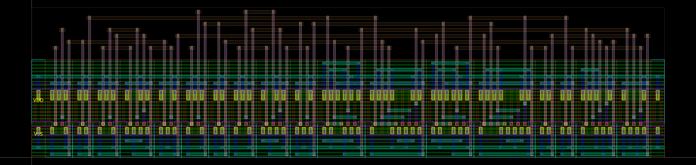

# ASAP7 sizing and physical-area experiments

Measured October 16, 2026. These experiments compare implementations of `ReLU(x1*w1 + x2*w2 + wb)` for ternary inputs and weights. They support architecture and sizing decisions; they are not a completed course submission.

## Results

Mirror 2:3 has the lowest screen T × measured A among the 14 routed cases. Mirror 3:3 has the same area and is a close timing finalist. Mirror 4:6 wins on screen delay alone, but its 12% larger area makes T × A 6.66% worse than 2:3. Within the AOI-XOR family, measured area favors 2:2 over the faster 3:3.

| Case (N:P fin counts) | Width × height (µm) | Measured area (µm²) | Screen T (ps) | Screen T × A (ps·µm²) |
| --- | ---: | ---: | ---: | ---: |
| mirror_n2_p3 | 5.022 × 1.200 | 6.026400 | 47.174 | 284.291 |
| mirror_n3_p3 | 5.022 × 1.200 | 6.026400 | 47.388 | 285.577 |
| mirror_n2_p2 | 5.022 × 1.152 | 5.785344 | 50.706 | 293.351 |
| mirror_n4_p6 | 5.022 × 1.344 | 6.749568 | 44.924 | 303.218 |
| mirror_n1_p1 | 5.022 × 1.104 | 5.544288 | 62.217 | 344.948 |
| aoi_xor_n2_p2 | 6.534 × 1.200 | 7.840800 | 48.431 | 379.735 |
| aoi_xor_n3_p3 | 6.534 × 1.248 | 8.154432 | 47.180 | 384.727 |
| aoi_xor_n4_p6 | 6.534 × 1.392 | 9.095328 | 47.950 | 436.123 |
| mirror_n1_p6 | 5.022 × 1.248 | 6.267456 | 80.559 | 504.897 |
| mirror_n4_p1 | 5.022 × 1.200 | 6.026400 | 85.385 | 514.567 |
| cmos_xor_n2_p2 | 8.478 × 1.296 | 10.987488 | 54.542 | 599.284 |
| aoi_xor_n4_p1 | 6.534 × 1.248 | 8.154432 | 81.138 | 661.637 |
| cmos_xor_n4_p6 | 8.478 × 1.488 | 12.615264 | 58.462 | 737.515 |
| cmos_xor_n1_p6 | 8.478 × 1.392 | 11.801376 | 98.802 | 1166.000 |

The ranking uses the same 103-transition screen for every row. Full-history timing is separately recorded in [evidence.json](evidence.json). A screen can miss a worst case: CMOS-XOR 2:2 rises from 54.542 ps on the screen to 58.524 ps in the full history. Timing depends on stimulus history, so the screen and full runs must not be mixed in one ranking.

## Coverage and conditions

- **72 screens:** three topology combinations, NMOS fins 1–4 and PMOS fins 1–6. All use the same 103 output-changing transitions and 107 unique states.
- **Seven full cases:** mirror 2:2, 2:3, 3:3; AOI-XOR 2:2, 3:3; CMOS-XOR 1:1, 2:2. The sequence visits all 243 legal states and tests all 1,944 directed transitions between distinct input pairs at fixed weights, of which 816 change the output. The mirror 2:2 / 3:3 and CMOS controls reuse existing simulations of the same DUT and conditions.
- **Two numerical reruns:** mirror 2:3 and 3:3, complete full histories at 1 ps maximum timestep. Their delays are 47.647175 and 47.732392 ps, respectively. Both have zero Spectre warnings. Some default 5 ps runs emitted numerical warnings; every run's count is retained.
- **14 physical layouts:** each topology's fastest screen, slowest screen and largest old estimated-area corner; additional mirror controls and opposite beta extremes; close 2:2, 2:3 and 3:3 comparisons. The other **58 grid points have no physical area evidence**.
- **Conditions:** ASAP7 r1p7 RVT, TT, 25 °C, 0.9 V, L = 20 nm, 1 fF on each output, 5 ps source edges, 1N/2P input-driver inverters and 300 ps per state. N:P denotes integer fins per device, not electrical β after mobility adjustment.

All recorded runs have zero functional failures, rail-margin failures and missed transitions. Functional checks sample at 95% of the state interval; a high must exceed 90% of VDD and a low must remain below 10%. T is measured from the earliest 50%-VDD crossing of the changing DUT inputs to the last 50%-VDD crossing of either output within that transition window. `launch_delay_ps` instead references the ideal stimulus edge and is kept separately. Same-output glitches are recorded separately in the full histories.

## What each topology changes

| Key | Multiplier | Full adder | Output logic | Transistors |
| --- | --- | --- | --- | ---: |
| `mirror` | Folded 10T NAND/OAI XNOR | Mirror carry/sum networks | Complex NOR3/AOI211 ReLU | 106 |
| `aoi_xor` | Folded 10T NAND/OAI XNOR | Complex-gate XOR-based | Complex NOR3/AOI211 ReLU | 122 |
| `cmos_xor` | Direct CMOS-XOR implementation | CMOS XOR-based | Simple output logic | 146 |

The 10T count refers to the XNOR gate; each complete folded multiplier has 20 transistors. These are complete implementation combinations. Differences involving `cmos_xor` cannot be attributed solely to the full adder. All use the carry-save counting architecture. Source CDL port order is `i0 ... i9`, two outputs in least-significant-bit order, then `VDD VSS`; inputs encode `x1, x2, w1, w2, wb`, each least-significant bit first. Codes are 00 = 0, 01 = +1, 11 = −1; code 10 is outside the legal domain. Calibre's extracted port order differs, so use its `.SUBCKT` header when instantiating it.

## Physical verification and area

Each layout is a regular single-row implementation with uniform cell height, shared diffusion where the generated transistor ordering permits it, two physical body taps, M2 power rails, M3 drops and M4 horizontal routing. Its boundary encloses the neuron and routing, excluding the testbench drivers and load capacitors. Each area was measured from GDS layer 100/0 and independently from the imported Virtuoso OpenAccess boundary. The original [Virtuoso boundary export](layouts/virtuoso-boundaries.txt) is included.

All 14 cases pass **334 Calibre DRC rule checks with zero errors** and **LVS CORRECT**. Body taps are present; no virtual supply connections or latch-up-rule waivers were used. The extracted MOS connectivity independently gives the correct output for all 243 legal states. This is connectivity extraction, **not RC parasitic extraction or post-layout timing**.

The GDS, source CDL, Calibre extracted MOS netlists and native Virtuoso PNGs in [layouts/](layouts/) are the actual experiment artifacts. PNGs are unmodified exports, not illustrations. Full DRC/LVS logs are retained outside this public package; their SHA-256 fingerprints and parsed status fields are recorded in `evidence.json`. Local paths, license-server information, PDK models and foundry rule decks are not distributed here.



Mirror 2:3: 5.022 × 1.200 µm, 6.026400 µm². This area is achievable with the supplied routing, not an optimum or a lower bound.

## Reproduction

### Check the published evidence without EDA licenses

From the repository root, follow the environment setup in the [main README](../../README.md#run-it), then run:

```sh
make check PYTHON=build/venv/bin/python
```

The checker verifies published file hashes, sweep coverage, per-transition measurements, native/GDS area agreement and all 243 legal states of every extracted transistor network. It checks the consistency of saved DRC/LVS status fields but does not rerun those tools or certify the saved logs independently.

### Replay a Spectre deck

Requires a licensed Spectre installation and separately obtained ASAP7 r1p7 TT models. The recorded simulator version is 25.1.0.367.isr9. The decks in [spectre/](spectre/) preserve the simulated devices and stimuli exactly; only the machine-specific model include was replaced with `asap7_TT.pm`. The source and published SHA-256 values are recorded in [manifest.json](manifest.json).

From the repository root, use a scratch directory so replayed outputs do not overwrite evidence:

```sh
mkdir -p build/replay
cp experiments/2026-10-16/spectre/mirror_n2_p3_fine1ps.scs build/replay/
ln -s /absolute/path/to/asap7/models/hspice/7nm_TT.pm build/replay/asap7_TT.pm
cd build/replay
spectre mirror_n2_p3_fine1ps.scs -format psfascii -raw mirror_n2_p3_fine1ps.raw
```

The model path is an explicit placeholder for the local installation. If the installed model requires adjacent include files, preserve that model directory structure. Compare measurements using the thresholds above and the exact [screen](spectre/screen.json) or [full](spectre/full.json) state/test history. The [measurements](measurements/) directory contains the per-transition timing records (two reused-source path labels were made portable; values are unchanged) and worst-case vectors for all 81 runs. Binary/raw transient waveforms are not included.

### Recheck physical layouts

Requires licensed Calibre and the same installed ASAP7 `2022-fixed` r1p7 rule deck distribution. The recorded version is Calibre 2025.4_36.20. Use the supplied GDS as layout and matching CDL as source, with the cell name from the filename and explicit `VDD` / `VSS` power and ground names. Set the PDK routing offsets `VAR_M4_YOFFSET`, `VAR_M5_XOFFSET`, `VAR_M6_YOFFSET` and `VAR_M7_XOFFSET` to zero. The distribution's DRC deck expects a `test.gds` with a `TOPCELL` wrapper referencing the neuron at the origin; LVS uses the neuron cell itself. Do not add virtual supply connections. Decks and environment setup must come from the local authorized installation.

For native inspection, import the GDS using the ASAP7 technology/layer map, open the neuron layout, and measure its `BOUNDARY` layer. The exports were produced with Virtuoso IC25.1-64b.ISR6.31.

## Limits and next measurements

The delay-area products combine pre-layout Spectre delay with real physical area. RC extraction may change both the worst path and the close 2:3/3:3 ranking. These single-row layouts have not been compacted or compared with alternative placement/routing. There is no measured spec-datapath layout in this package. The beta sweep does not include new finalist load/slew/PVT sweeps, Monte Carlo variation, a global area optimum, or physical areas for the other 58 points. The earlier 2:2 sensitivity results cannot establish 2:3 robustness.

## Provenance

The machine-readable [evidence](evidence.json) records tool versions, conditions, verification timestamps and original report fingerprints. The [manifest](manifest.json) hashes every published measurement, layout and simulation deck, and records any transformation. Experiment artifacts and publication tooling were produced with OpenAI Codex assistance; exact historical model identifiers were not recorded. Existing model and calibration authorship remain in Git history.
